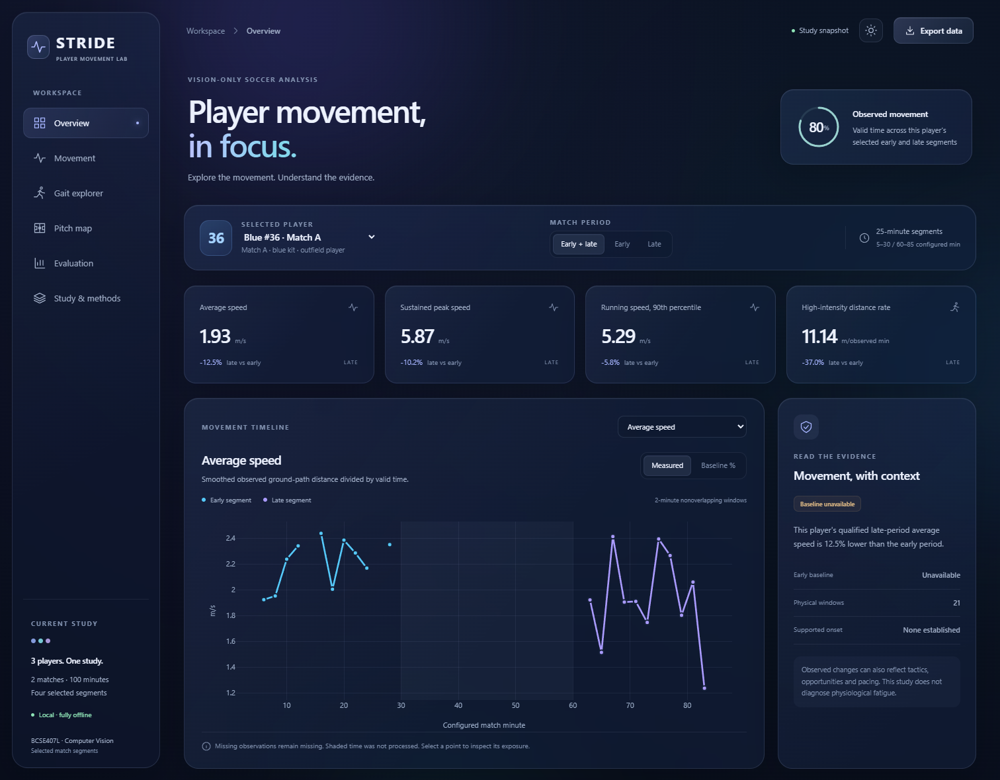

# Player Fatigue Detection from Football Video

BCSE407L Computer Vision mini-project: pretrained person detection and pose estimation, player tracking, calibrated field movement, gait features and statistical analysis of fatigue-related movement changes. The completed study covers **three players, two matches and four 25-minute segments**, with a separate five-clip broadcast audit.

The **React liquid-glass dashboard** provides six interactive evidence views, dark/light themes, responsive layouts, player/period filters, chart inspection, pitch playback and data export.



## Open the dashboard

The finished dashboard is a **single offline HTML file**. No Python, Node.js, GPU or web server is needed just to view it.

1. Clone/download this repository, or download the [dashboard HTML](https://github.com/srutan2004/Player-Fatigue-Detection/raw/refs/heads/main/results/phase4/dashboard.html).
2. Open `results/phase4/dashboard.html` in a modern browser. GitHub's file viewer shows source code; open the downloaded file locally.

In the existing Windows workspace:

```powershell
Set-Location 'D:\Computer Vision'
Start-Process '.\results\phase4\dashboard.html'
```

| Dashboard section | What you can inspect |
|---|---|
| Overview | Qualified movement summaries, timeline, early/late bars and coverage |
| Movement | Eight metrics, physical/baseline modes, window details and analysis status |
| Gait explorer | Individual cycles, leg/speed filters and running-speed relationships |
| Pitch map | Observed trajectories, gaps, time scrubbing, playback and sampled occupancy |
| Evaluation | Detector, tracker, calibration, broadcast and software-control results |
| Study & methods | Dataset scope, models, thresholds, baselines, sensitivity and eligibility |

The dashboard embeds React, Plotly, styles and saved evidence. Its controls explore those results; new-video inference runs through the Python pipeline.

## Project documentation

| Document | Read it for |
|---|---|
| [explanation.md](explanation.md) | Full working explanation: basics through models, data, equations, statistics, graphs and viva questions |
| [FINAL_REPORT.md](FINAL_REPORT.md) | Recorded study findings and completed deliverables |
| [PHASE_1_3_REPORT.md](PHASE_1_3_REPORT.md) | Measurement-stage audits, hardware and model choices |
| [PRESENTATION_CONTENT.md](PRESENTATION_CONTENT.md) | Twelve-slide presentation text and suggested visuals |
| [dashboard/README.md](dashboard/README.md) | React source, build and browser QA |
| [LIMITATIONS.md](LIMITATIONS.md) | Scientific and measurement boundaries |
| [FOUR_PHASE_IMPLEMENTATION_PLAN.md](FOUR_PHASE_IMPLEMENTATION_PLAN.md) | Four-phase roadmap |
| [IMPLEMENTATION_PLAN.md](IMPLEMENTATION_PLAN.md) | Original detailed implementation design |

## Models and recorded results

The final models are **pretrained YOLOv8n** for person detection and **pretrained YOLOv8m-Pose** for joints. ByteTrack associates detections into tracklets. Validated field geometry converts detected ground anchors to meters; feature engineering and time-series methods summarize the observations. There is no trained fatigue classifier.

One detector fine-tuning experiment used **387 train / 100 validation / 100 held-out-match tiles**, 15 epochs, batch 4, frozen early layers and mixed precision. It took approximately **258 seconds including evaluations** on the RTX 4060 Laptop GPU. Pretrained validation mAP@0.50:0.95 was **0.7105**, versus **0.6803** after adaptation, so the pretrained detector was retained. Pose was not fine-tuned.

| Selected detector, held-out 100-image test | Result |
|---|---:|
| Precision | 94.68% |
| Recall | 89.98% |
| mAP@0.50 | 93.10% |
| mAP@0.50:0.95 | 72.32% |

These scores evaluate person detection. The qualified Blue #36 early/late case shows **12.5% lower observed average speed** and **37.0% lower high-intensity distance rate** in the selected late segment. Only one player qualifies for the paired movement comparison; accepted cycles do not form eligible longitudinal gait windows. No supported fatigue-onset time is claimed. Full evidence and statistical interpretation are in [explanation.md](explanation.md) and the final report.

## Python setup

Tested on **RTX 4060 Laptop GPU, 8 GB VRAM; Ryzen 7 7840HS; 16 GB RAM; Python 3.12**. Install [uv](https://docs.astral.sh/uv/getting-started/installation/), Git and a compatible NVIDIA driver.

```powershell
git clone https://github.com/srutan2004/Player-Fatigue-Detection.git
cd Player-Fatigue-Detection
uv sync --locked --group dev --group notebook
uv run --no-sync python -m src.cli check-environment --smoke-models
```

`scripts/setup.ps1` also installs the runtime/dev environment and runs checks. CUDA PyTorch 2.8.0 and torchvision 0.23.0 use the explicit CUDA 12.8 wheel index. The checks exercise CUDA multiplication, torchvision NMS and pretrained inference. `uv.lock` is authoritative; `requirements.txt` is a pip fallback after installing compatible CUDA torch/torchvision. The notebook group is needed for Jupyter.

## Dataset and reproducibility

The main source is [SoccerTrack v2](https://huggingface.co/datasets/atomscott/soccertrack-v2), v1.2, pinned to `325bd4c57ee8e135ab652f3921d274526ada496b`. Selected downloads include both panoramic halves and GSR annotations of matches **117093 and 128057**, their curated MOT clips/labels and camera assets.

- Main source files: **25.29 GB**, including approximately **184.05 minutes** of panoramic video.
- Longitudinal study: **100 distinct footage minutes**, three players, 225,000 native target-frame records and 72 nonoverlapping analysis windows.
- Separate [SoccerNet-GSR](https://huggingface.co/datasets/SoccerNet/SN-GSR-2024) broadcast audit: five test clips, 300 sampled images, approximately **175 MB extracted**. Selected archive members were fetched; the complete test ZIP was not downloaded.
- Detector training/validation use Match A; detector testing uses Match B. Broadcast samples are a separate audit, not training or longitudinal fatigue data.

Exact source files, sizes and hashes are in [data/manifests/downloads/](data/manifests/downloads/); the cohort is fixed in [study.json](data/manifests/study.json). Files retain upstream paths under `data/hub/`, avoiding duplicate multi-GB copies. Source schema details are documented by the [upstream project](https://github.com/AtomScott/SoccerTrack-v2/blob/main/docs/format-gsr.md).

Accept the dataset's access conditions and authenticate in the terminal. Browser login alone does not authenticate Python:

```powershell
uv run --no-sync hf auth login
uv run --no-sync python -m src.cli dataset-probe --match 128057 --output results/phase1/dataset_128057.json
uv run --no-sync python -m src.cli dataset-download --probe results/phase1/dataset_128057.json --max-gib 12 `
  --file videos/128057/128057_panorama_1st_half.mp4 `
  --file videos/128057/128057_panorama_2nd_half.mp4 `
  --file gsr/128057/128057_1st.json `
  --file gsr/128057/128057_2nd.json
```

Enter credentials privately. Downloads are bounded and resumable. For a full rerun, acquire the corresponding files for Match A plus the required MOT/camera assets listed in the manifests. Build reference indexes for both matches/halves, for example:

```powershell
uv run --no-sync python -m src.cli reference-index data/hub/gsr/128057/128057_1st.json `
  --output data/processed/128057_first.sqlite --index-base 1
```

Use `MATCH_second.sqlite` for each second half. GSR suffix numbering is one-based; curated MOT numbering is zero-based. Raw videos, annotations, credentials, model binaries, executed notebooks, footage previews and native-frame caches remain local and are excluded from Git. Published derived tables and the offline dashboard can be inspected without downloading footage.

## Run the pipeline

The four study YAMLs define sources, intervals, models, identities and calibration. On a fresh clone, remove `pipeline.cached_tracks` when the referenced local tracker caches are absent. The published fitted mappings apply only to their unchanged source cameras. Study identity association needs the prepared reference indexes.

```powershell
# Inspect a short pilot before a costly extraction:
uv run --no-sync python -m src.cli inspect --config configs/pilot.yaml
uv run --no-sync python -m src.cli pilot --config configs/pilot.yaml

# Resume the configured study; GPU stages run sequentially:
uv run --no-sync python scripts/run_study.py
uv run --no-sync python scripts/finalize_phase3.py

# Baselines, trends, sensitivity, comparisons, figures and dashboard:
uv run --no-sync python -m src.cli analyze
```

Existing matching vision outputs are reused. Full sensitivity analysis requires local frame-level caches; published summary tables alone do not replace them. The curated detector experiment is optional and is not repeated automatically. Its single-run registry prevents accidental retraining.

The end-to-end notebook uses the same modules:

```powershell
uv run --no-sync jupyter lab notebooks/pipeline_demo.ipynb
```

For **a new local video**, copy a YAML, set new source/output paths and times, establish and validate its field mapping, then use `select-player` with reference assistance disabled to configure the initial target tracklet. Reviewed later tracklet intervals can handle reappearances. Run `extract`, `pose-pass` and `metrics`, then configure the new cohort's analysis inputs. See [the detailed new-video workflow](explanation.md#142-a-new-permitted-local-video). A fixed map is suitable only while the camera geometry remains valid.

## Rebuild the React dashboard

After editing JSX/build source, install Node.js and use the locked frontend environment:

```powershell
npm --prefix dashboard ci
npm --prefix dashboard run build
uv run --no-sync python scripts/render_dashboard.py
```

Then reopen/refresh `results/phase4/dashboard.html`. The renderer rebuilds presentation from saved evidence without rerunning vision or statistical analysis. The committed `dashboard/assets/app.js` means Node.js is unnecessary for normal Python exports when the client source has not changed. When local trajectory caches are absent, the renderer can reuse embedded trajectories only from the same recorded analysis snapshot.

## Measurements and statistics

Movement metrics are average speed, sustained peak speed, running-speed p90 and high-intensity distance per observed minute. Gait metrics are same-leg cadence, stride-length proxy, projected vertical motion and knee-flexion excursion. Body motion in image space is not physical vertical height.

Primary inference uses **120-second nonoverlapping windows**; display windows step by 60 seconds. Coverage and accepted-cycle gates determine which values are usable. No smoothing/displacement crosses identity breaks or missing segments. Own-player baselines, lag-1 HAC regression uncertainty, Holm correction, PELT searches and smoothing/window/penalty sensitivity support interpretation. Early/late comparisons use players as the independent unit; Wilcoxon is gated on sufficient paired players. See [the equations and statistical explanation](explanation.md#7-feature-engineering-the-measurements-and-equations).

## Outputs and checks

| Location | Contents |
|---|---|
| `results/phase2/training/` | Detector experiment and comparison |
| `results/phase2/calibration/` | Fitted field maps and held-out point errors |
| `results/metrics_csv/` | Combined windows, accepted gait cycles, units and coverage |
| `results/plots/` | Measurement-stage plots, trajectories and cycle/speed comparisons |
| `results/phase4/plots/` | Eight final metric panels and early/late summary; canonical copies |
| `results/phase4/` | Baselines, normalized windows, trends, sensitivity, comparison/status tables, dashboard and audit |
| `results/completion_report.json` | Software completion and scientific availability |
| `results/reproducibility.json` | Source/artifact hashes for the recorded delivery snapshot; local file |

```powershell
uv run --no-sync pytest -q
uv run --no-sync ruff check src scripts tests main.py
npm --prefix dashboard run format:check
```

Browser QA uses installed Microsoft Edge through an isolated Playwright environment:

```powershell
uv run --isolated --no-project --with playwright python scripts/dashboard_qa.py
uv run --no-sync python scripts/finalize_project.py
```

The latest browser report records **34 passing checks**, zero JavaScript errors and zero external runtime requests, including all players, exports, empty states, pitch interactions, both themes and six mobile views. The finalizer checks tests, lint, dependency lock, completed notebook, dashboard hash, controls and required artifacts before recording completion. It needs the local executed outputs; a clone containing published summaries alone is not a complete inference workspace.
